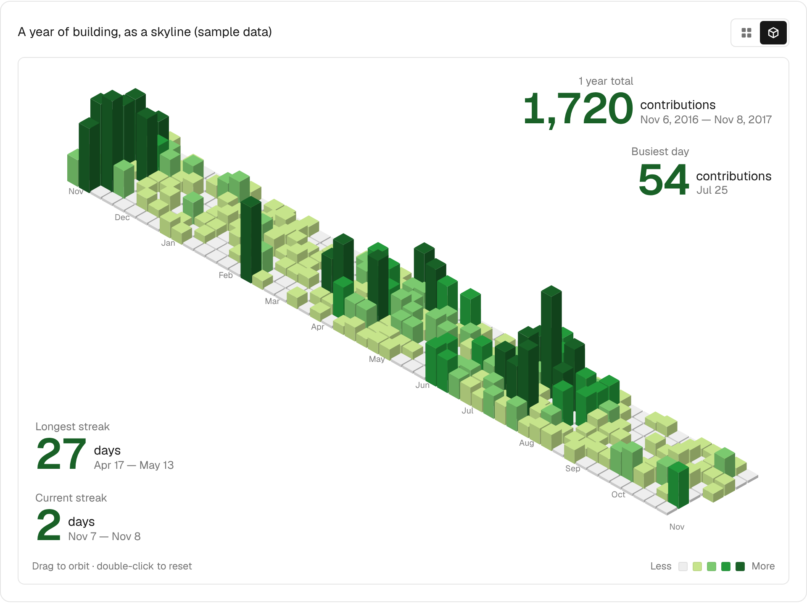

👋 Hi, I’m Timothy Lee Yung Yau (username: @timothylee58)
- Malaysian
- Gen-Z

## Featured: Contribution Skyline

A year of activity as a GitHub-style heat map that folds up into an isometric 3D skyline. Canvas + React, no chart library. Built for my portfolio site (Next.js, TypeScript, Tailwind, shadcn/ui), and it lives in [`src/components/ui/contribution-skyline.tsx`](src/components/ui/contribution-skyline.tsx).

Static preview rendered from generated sample data. The live component is interactive: hover a day for its count, arrow keys to explore, drag to orbit, and toggle between the flat and 3D views.

## About Me
I built full-stack, AI-powered applications — and I bring logistical operational context that most developers don't have.

My computer science background and working experience spans 3+ years in logistics operations and CRM workflows, 1 year each for restaurant merchant POS onboarding & support, and social media marketing. That experience sharpened my instinct for what makes software genuinely useful: reliability, speed, and smooth workflows that match how people actually work. I'm enthusiastic in building Agentic Workflows and Production-Grade RAG systems that solve real-world bottlenecks. My background isn't just in code—it's in the trenches of MNC startups.

Technically, I build with Next.js, FastAPI, PostgreSQL stack, with a focus on CI/CD and system reliability on top of modern stacks — Python, HTML5, CSS3, Tailwind, JavaScript, TypeScript, Pandas, NumPy, Scikit-Learn, Node.js, OpenCV, Webhooks, and RESTful APIs. On the infrastructure and cloud hosting side, I work with Supabase (Postgres), Redis, Render, Vercel, Github Actions, AWS, GCP, Azure and Cloudflare to ship and maintain production-grade applications. I also thrive in prompt engineering environments where rapid shipping meets rigorous engineering standards.

I'm deeply comfortable and familiar with AI-augmented development. Multiple LLM models are part of my workflow such as Claude Code, Codex, Cursor and etc — not shortcuts, but force multipliers on top of solid fundamentals.

Currently upskilling in machine learning & data science to deepen how I design systems and extract insight from data.

I'm actively seeking AI engineer or automation and software engineering roles — open to internships or permanent positions. I build with AI and build for AI. If you're building something meaningful and impactful - 

Let's connect.

- 📫 How to reach me ...

## Socials

- https://jomqr.my/yungyaulee
[Personal Website: Soon]

